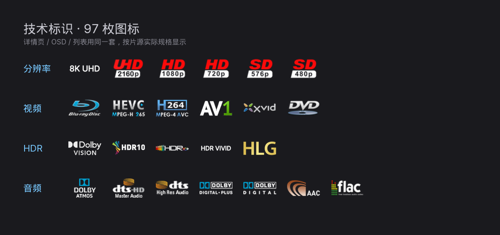

# Mistuary（雾汐）

雾汐｜轻量透明皮肤，衍生自 Estuary N，视频优先。支持**透黑 / 透白**双主题，
三档独立透明度，原生 Kodi 22 及以上即可运行，**不需要任何内核改动**。

> 建议搭配 **Emby for Kodi next gen**（媒体库自动同步）和可选插件 **Mistuary Helper**
> （详情页豆瓣评分、Emby 服务端搜索）。

---

## 支持范围

| 项 | 说明 |
|---|---|
| Kodi 版本 | **22 及以上**（要求 `xbmc.gui` 5.18.0，见下文） |
| 平台 | Windows / Linux / CoreELEC / Android 均可 |
| 语言 | 简体中文、English |
| 必需插件 | 无。装 Emby 插件会更好用，但不装也能跑 |

## 安装

**从压缩包安装（推荐）**

1. 到 [Releases](https://github.com/wabisabi926/skin.mistuary/releases) 下载最新 `skin.mistuary-x.y.z.zip`
2. Kodi → 设置 → 插件 → 从 zip 文件安装
3. 设置 → 界面 → 皮肤 → 皮肤 → 选 **Mistuary**

**手动安装**：把整个仓库目录放到 Kodi 的 `addons/` 下，目录名改成 `skin.mistuary`，重启 Kodi。

## 升级与回退

**升级**：直接装新版本的 zip，Kodi 会提示「已安装，是否覆盖」，选是。
皮肤设置存在 `userdata/addon_data/skin.mistuary/`，覆盖安装**不会丢**。

**回退**：到 [Releases](https://github.com/wabisabi926/skin.mistuary/releases) 找旧版本的 zip，
同样方式装上即可。注意 **1.5.2 起要求 Kodi 22**，要回到 Kodi 21 得用 1.5.1 或更早。

**什么时候必须重启 Kodi**（只重载皮肤不够）：

| 改了什么 | 生效方式 |
|---|---|
| XML / 贴图 / 语言文件 | 重载皮肤 |
| 装 / 卸 Mistuary Helper、Emby 插件 | 重载皮肤 |
| `addon.xml` 的依赖声明、皮肤版本号 | **完全退出 Kodi 再打开** |
| 字体（`Font.xml` / `fonts/*.ttf`） | **完全退出 Kodi 再打开** |

## 可选插件：Mistuary Helper

详情页豆瓣评分和 Emby 服务端搜索由独立插件提供；**不装皮肤也能正常用**，只是少这两项。

1. 从 [Mistuary Helper Releases](https://github.com/wabisabi926/script.mistuary.helper/releases)
   下载 `script.mistuary.helper-<ver>.zip`
2. Kodi → 插件 → 从 zip 安装，然后在「我的插件 → 程序插件」里启用
3. **重载皮肤**（设置 → 界面 → 皮肤 → 重新加载）

> 装 / 卸插件后不重载皮肤，新分支不会生效。搜索还需要 **Emby for Kodi NextGen**；
> 豆瓣评分只需要 IMDb id，不依赖 Emby。建议使用 0.3.3 及以上。

## 为什么用它

- **不需要魔改内核**：原版 Kodi 22 直接跑。很多透明皮肤依赖定制内核的玻璃、
  圆角扩展，装不上就是黑屏或者效果全丢；这里全部换成标准控件 + 贴图，Windows、CoreELEC、
  安卓通用。
- **小而快**：整个包 **7.2 MB**、749 张贴图。焦点移动没有拖影，切视图不掉帧。
- **不绑插件**：皮肤本体**零依赖**，不用装任何 Python 脚本。Emby、TMDbHelper 都是
  "装了更好"，不装也能完整使用。
- **三档透明度分开调**：页面、浮窗、播放中各 6 级，互不影响 —— 多数皮肤只有一个总开关，
  调完连对话框都跟着变。

## 主要功能

| | |
|---|---|
| **界面** | 真圆角海报墙（遮罩裁切，不是拿色块盖角）、焦点环贴边、详情页全屏沉浸、演员栏点开 |
| **元数据** | 评分胶囊（豆瓣 / IMDb / TMDB / 烂番茄，按数据源自动取最多两个；豆瓣需可选插件）、技术标识做成图标 |
| **音乐** | 播放页右侧歌词（CU LRC）、黑胶唱片模式、可替换播放背景 |
| **系统** | 电源菜单按平台能力自动显隐、设置中心把 Kodi 原生设置和皮肤选项放在一起 |

> 技术标识是 **97 枚随包图标**（分辨率 / 视频编码 / HDR / 音轨），按片源实际规格显示，
> 不是文字标签，也不从外部拉取。上面这张是从 `media/techflags/` 里取的真实图标。

## 透黑 / 透白

同一套玻璃，两种压色方向，在「设置 → 界面 → 皮肤 → 颜色」切换：

- **透黑**（`SKINDEFAULT`，默认）：玻璃压黑，暗环境看片不刺眼 —— 这套皮肤的常态
- **透白**（`light`）：玻璃提白，白天或亮环境下更清爽

面板分 6 级明暗，由「皮肤设置 → 外观」的三个透明度设置控制；两种模式下文字都是白色。

## 常改的几个设置

设置页**底部有帮助条** —— 聚焦哪一行就显示那一行的说明，不用查文档。
下面只列最常动的几个：

| 设置 | 位置 | 管什么 |
|---|---|---|
| **页面 / 弹窗 / 播放中透明度** | 皮肤设置 → 外观 | 三档各 6 级。页面管全屏页面和页面里的卡片；弹窗管对话框、菜单、键盘；播放中管 OSD、播放列表、书签 |
| **主评分来源** | 皮肤设置 → 常规 | TMDb / IMDb / 豆瓣 / 自动。选「豆瓣」需要神医助手（StrmAssistant）把 Emby 的评分改写成豆瓣分 |
| **次评分来源** | 皮肤设置 → 常规 | 自动 / 豆瓣 / 烂番茄 / 关闭。一行最多两颗评分胶囊 |
| **媒体标识** | 皮肤设置 → 常规 | 关掉后详情页和列表不再显示 4K / HDR / 音轨图标 |
| **自动滚动** | 皮肤设置 → 常规 | 长标题、长简介自动滚动 |

> 评分**一行最多两颗**：主评分 + 次评分。次评分选「豆瓣」时，如果和主评分同值就不重复显示。

## 为什么只支持 Kodi 22

技术标识（4K / HDR / 杜比视界 / 音轨格式）用 `$MAP[]` 做「值 → 图标」映射，
这是 **Kodi 22 才引入**的语法。Kodi 21 不展开它，会把
`$MAP[NaraTechnicalHdrIconMap,dv]` 原样画在屏幕上 —— 与其让 21 用户看到一堆表达式，
不如直接要求 22。

`addon.xml` 声明 `xbmc.gui 5.18.0`，Kodi 21 会在**安装时直接拒绝**，
不会出现「装上了但界面是坏的」。

还在 Kodi 21 上的人可以用 **1.5.1 及以前的版本**，那些版本技术标识会退化成纯文字。

> 1.5.1 及以前确实做过「21 用文字、22 用图标」的双轨分支，但两版行为差异越修越多、
> 21 也一直没在实机上验证过，1.5.2 起直接砍掉，只留一条渲染路径 ——
> 少一个分支就少一类「只有某种设备上才复现」的 bug。

## 已知限制

- **安卓上电源菜单只有「退出 / 设置」**：Kodi 在安卓没有关机、重启的系统权限，皮肤补不了
- **杜比视界档位（P7 / P7 FEL）只在 Kodi 22 显示**：Kodi 的播放信息里没有这个字段
- **不维护天气、电台、游戏界面**：只保留视频、音乐、图片、PVR、插件
- **只维护中英双语**：其他语言会显示英文
- **详情页点演员看作品需要 `script.embuary.info`**：没装时会提示安装（可拒绝，不影响其他功能）
- **本地搜索只匹配标题 / 原名 / 拼音首字母**：中文演员名与类型由服务端桥支持（需 Helper 0.3.3+）
- **豆瓣次评分只在详情页显示**：列表 / 首页不显示豆瓣，次评分退化为烂番茄

## 常见问题

**装了皮肤没变化，还是原来的皮肤**
设置 → 界面 → 皮肤 → 皮肤 → 选 **Mistuary**。
如果刚换过版本号或依赖声明，需要**完全退出 Kodi 再打开**，光重载皮肤不够。

**背景全黑，没有剧照**
1. 看 皮肤设置 → 艺术图片 → 有没有关掉背景图相关的开关
2. 确认 Emby 给这部片提供了 fanart（纯本地刮削的库可能没有）
3. 搜索页的背景是「渐变 + 随机剧照」，属于设计，不是没加载出来

**技术标识（4K / HDR / Atmos）不显示**
1. 确认 Kodi 是 **22**（设置 → 系统信息）。1.5.2 起 21 装不上，也不用装
2. 确认片源本身带这些信息 —— 纯 Kodi 刮削的库只有分辨率，没有 HDR / 音轨规格
3. 剧集和季在列表里用「当前季第一集」代表；整部剧没有单集数据时是空的

**详情页没有豆瓣评分**
需要装可选插件 **Mistuary Helper**，并且片子要有 IMDb id。
想要和 Emby 应用内一致的分数，还得装神医助手（StrmAssistant）——
Helper 会优先读它的接口；没装时 Helper 直连豆瓣公开接口，可能被限流。

**搜索没有结果，或者只搜得到本地内容**
- 服务端搜索需要 **Emby for Kodi NextGen** + **Mistuary Helper** 都装好
- 只装皮肤时走本地搜索，只匹配标题、原名、拼音首字母
- 中文演员名、类型搜索只有服务端模式支持

**插件列表里图标是空白**
1.5.1 修过（原来只读 `Icon`，没读 `thumb`）。升到 1.5.2 后重启 Kodi 即可。

**2160 / 21:9 屏上元素偏左、右边空一条**
1.5.2 修了图片浏览对话框。其他界面如果还有类似问题，附截图提 issue。

**换透明度后没反应**
三个透明度是**分开**的：页面、弹窗、播放中各管一摊。
调「页面透明度」时播放 OSD 不会变，那由「播放中透明度」管。

## 许可

本皮肤**代码**与**美术素材**许可不同，另有若干第三方素材：

| 部分 | 许可 |
| --- | --- |
| 皮肤代码（`xml/`、`colors/`、`tools/`） | GNU GPL v2 —— 全文见 [`LICENSE`](LICENSE) |
| 美术素材（配色、布局、图标重绘、背景图） | CC BY-SA 4.0 |
| UI 字体 `fonts/Inter-Unicode-Regular.ttf` | SIL OFL 1.1 —— 全文见 [`fonts/OFL.txt`](fonts/OFL.txt) |

第三方素材的**完整来源、版本与许可声明**见 [`CREDITS.md`](CREDITS.md)
（tinyppi 图标 MIT、Inter 字体 OFL、Arctic Fuse 类型图标与技术标识 CC BY-NC-SA）。
分发或再发布时，`LICENSE`、`fonts/OFL.txt`、`CREDITS.md` 三个文件必须一起带上。

## 反馈

问题、建议、皮肤想法都可以开 issue：
<https://github.com/wabisabi926/skin.mistuary/issues>

---

开发相关（改皮肤、打包贴图、发版流程）见 [`docs/HANDOVER.md`](docs/HANDOVER.md)。
